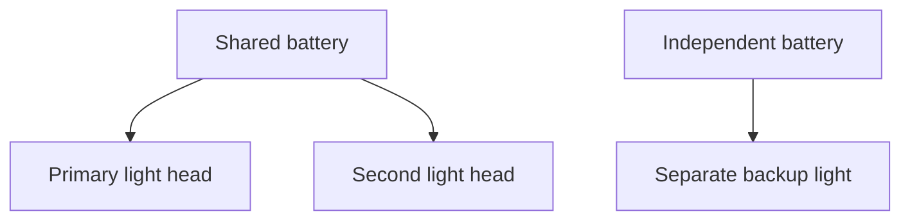

# Redundancy must survive the same failure

## Core idea

Equipment redundancy depends on what remains usable after a failure. A shared battery, inaccessible mounting or incompatible connection can defeat an apparent backup.

For the conventional open-circuit cave-diving context of these entries, each diver carries at least three separately powered lights: a primary and two backups. Check their operation, accessibility and duration against the planned dive and contingency requirements; a count alone cannot establish suitability. More demanding dives may require additional provision. A primary-light failure ends further penetration: use the backup and follow the team's trained exit procedure.

## Original example

A diver packs three light heads, but two draw power from the same battery. A failure of that battery removes both heads. Identify independent power and usable backup duration rather than counting visible lamps.

## Separate independence from endurance

Ask what a single failure disables. Separate switches do not separate a shared battery; greater battery capacity does not remove that dependency. A replacement part that must be fitted after failure is not the same as a usable independent backup.

Then ask how long the remaining equipment can perform its role. A switch-on check establishes present operation, not burn time. Compatibility, access and usable duration need their own assessment against the planned exposure and contingencies.

## Check understanding

What different questions are answered by checking independent power and checking usable burn time?

## Learning objective
Explain a backup's independence, accessibility and endurance as separate requirements.

## Trace the failure
Draw the power supply, light head and mounting for each light. A battery failure affects every attached head. A mounting problem can make a functioning light unusable. Independent power solves the first problem but does not establish reachability or sufficient duration.

For breathing and buoyancy equipment, trace which components share a gas supply and what remains accessible after a specified failure. Owning two components does not establish that either remains usable. Configuration-specific valve responses belong to supervised training.

## Compare cases
Three independently powered lights can still be unsuitable if backup duration has not been established. Conversely, a very long burn time does not fix a shared battery dependency. Explain the evidence required for each case rather than ranking equipment by count alone.

## Original dependency schematic
This drawing shows a fictional shared-power arrangement, not a recommended configuration.

If the shared battery fails, two heads become unavailable. Count what remains usable after that event, then assess duration and access separately.
