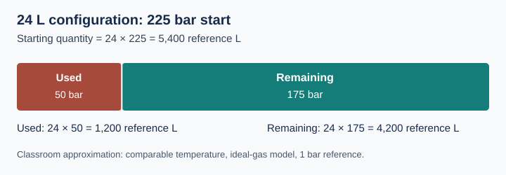

# Convert between bar and reference litres

## Prerequisites

GAS-004: identify V, p and Q.

## Learning objective

Convert in both directions, separate gas used from gas remaining, and verify an answer by reversing the calculation.

## Predict first

For the same gas quantity, will a larger cylinder require a higher or lower pressure? A larger container requires less pressure for the same quantity in this model.

## Visual model

The diagram uses the worked example below. Ask the learner to identify the **pressure drop** and **remaining gauge reading** separately before calculating. The labelled text and table below provide the same information without relying on the graphic.

## Two directions

At the stated 1 bar reference, use Q = V × p / 1 bar and p = Q × 1 bar / V. For a change in pressure, gas used is V × (start pressure − current pressure) / 1 bar. Keep the labels on each result: gas used is not gas remaining.

## Worked example

A 24 L configuration starts at 225 bar and now reads 175 bar. The pressure drop is 225 − 175 = **50 bar**. Gas used is 24 × 50 = **1,200 reference L**. Gas remaining is 24 × 175 = **4,200 reference L**. Their sum is 5,400 reference L, matching 24 × 225.

Converting the used gas back gives 1,200 / 24 = **50 bar of pressure drop**, not a 50 bar gauge reading. The gauge reading is 225 − 50 = 175 bar.

| Given gas quantity | Water volume | Equivalent pressure or pressure change |
| --- | --- | --- |
| 1,200 reference L | 24 L | 50 bar |
| 1,200 reference L | 20 L | 60 bar |

## Guided calculation

A 20 L configuration falls from 220 to 175 bar. Calculate the pressure drop, used quantity and remaining quantity. Add the two quantities and compare with starting inventory.

## Guided answer — reveal after the learner attempts

Drop = 45 bar; used = 20 × 45 = **900 reference L**; remaining = 20 × 175 = **3,500 reference L**. Their sum is 4,400 reference L. Reverse check: 900 / 20 = 45 bar, and 220 − 45 = 175 bar.

## Explain before moving on

Why does converting a gas quantity to bar require knowing which cylinder configuration is involved?
