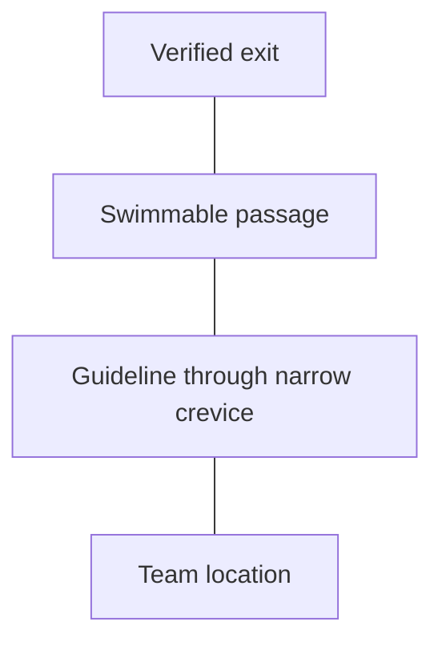

# Continuous guideline to a verified exit

## Terminology

Read the relevant definitions in [GLOSSARY.md](../../GLOSSARY.md) before assessment.

## Core idea

In an underwater cave, a diver cannot assume that a direct ascent to the surface is possible. A continuous guideline leading to an exit that the team has positively verified is a fundamental navigation safeguard.

A break in continuity along the team's route can make orientation and exit much harder, especially if visibility is lost. A visible line somewhere nearby is not a substitute for a continuous, identified route.

## Practical understanding

A line may be permanent or temporarily deployed. What matters for the team's navigation is that the route to its verified exit remains continuous and unambiguous. Junctions and changes of line require deliberate decisions and appropriate markers or connectors under the team's agreed procedures.

Do not assume that a directional arrow, an unfamiliar line, or a map proves an exit is accessible. Conditions and installations can change.

## Limitations

This is a concept overview, not instructions for placing reels, negotiating a junction, or making a cave penetration. Those skills require appropriate supervised training and local procedures.

## Separate navigation functions

A compass heading supplies direction; a recognizable feature supplies a visual reference; a guideline supplies a physical route reference. These can complement each other, but their functions are not interchangeable. A visible main line still needs an appropriate connection to the team’s entrance guideline when the route between them lies under the underwater overhead.

After checking continuity, check route identity. A physically connected line network can still offer more than one return branch. Continuity and branch identification are separate requirements.

## Check understanding

Why might a route drawing need correction even when every line shown is physically connected?

## Learning objective
Distinguish continuous line, followable placement and verified return direction.

## A continuous line can still be unsuitable
A line trap occurs when the guideline runs into a space the diver cannot follow, such as a narrow crevice at a bend. The line can remain intact while its path is unusable, especially when followed by touch. Loose guideline can form loops and increase entanglement risk. Excessive tension or unsuitable placement can pull a line away from the swimmable route.

These are different questions: Is the line connected? Can the diver follow its actual path? Does the chosen branch lead to the team's verified exit? All three matter.

## Read an original schematic
The following is a conceptual drawing, not a cave map or an installation procedure.

Every segment is connected. The crevice is stipulated to pass the guideline but not the diver. Identify why connectivity alone is inadequate. A suitable installation must be evaluated for the actual passage and configuration under trained procedures.

## Team roles
The primary reel establishes the entrance connection where needed. During retrieval, team order must preserve everyone's continuous route; retrieving the line ahead of a diver can remove that diver's route reference. Agree roles and communication before entry. Recognizing a problem in a drawing does not demonstrate deployment, tie-offs or retrieval skills.
